# DocuVision

**An on-prem document intelligence system:** ingest paper and PDFs, extract structured fields with local vision models, isolate faults instead of crashing the worker, and require a human to verify every record before it is released.

The interesting part is not “call a vision model on a PDF.” It is how a long-running, memory-hungry, failure-prone pipeline is turned into an **explicit state machine** with protocol boundaries, shared contracts across Python and TypeScript, and a human-in-the-loop (HITL) gate that is part of the domain — not a UI bolted on afterwards.

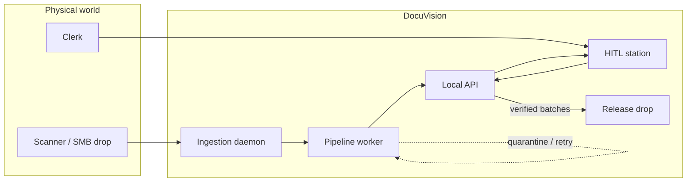

---

## What this repository is asking

The codebase is organized around a few design questions that show up repeatedly in the modules below.

| Question | Where the answer lives |
| --- | --- |
| How do you keep a document pipeline from depending on SQLite, Postgres, Ollama, or a filesystem layout? | `docuvision/core/` depends only on `typing.Protocol` surfaces in `contracts.py` |
| How do Python workers and a TypeScript UI stay bit-aligned on status names? | `contracts/*.json` generate both `PipelineStatus` and TS types at import / codegen time |
| How do you run Docling + GLM-OCR + Qwen-VL on a Mini PC without leaking VRAM across jobs? | `stages/gated_extraction.py`: spawned processes, RSS caps, exclusive GPU lock, session wipe |
| How do you stop a poisoned document from being claimed forever by a crash-looping worker? | Quarantine attempts, dead-letter after `max_retries`, CAS redrive |
| How do you treat a *batch of pages* as the unit of work, not a single file? | Migration 002 + `BatchSplitEngine` + HITL sequence navigation |
| How do you authenticate a desktop shell on an air-gapped LAN without a cloud IdP? | Loopback `X-API-Key` handshake + Argon2id / Ed25519 operator JWTs |

If you are reading this as a code reviewer: start with `docuvision/core/pipeline.py`, then `contracts.py`, then `stages/gated_extraction.py`. The rest of the tree is adapters, a FastAPI composition root, and a Next.js / Tauri verification station.

---

## Runtime topology

Three long-lived processes share a data root. The UI is a static SPA (or a Tauri wrapper around that SPA). Nothing in the happy path talks to the public internet.

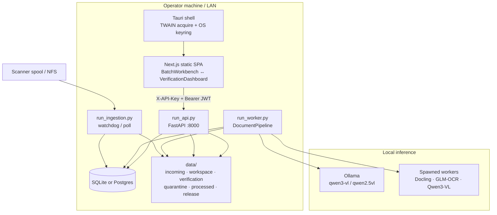

| Process | Entry | Responsibility |
| --- | --- | --- |
| Ingestion | `python run_ingestion.py` | Watch configured drop folders, settle files, package **batches** into `incoming/` |
| Worker | `python run_worker.py` | Claim one `QUEUED` job, run the state machine, write extraction JSON |
| API | `python run_api.py` | HITL queue, PDF stream, verify/reject, split, quarantine redrive, release |
| UI | `npm run dev` / `tauri dev` | Clerk station: batch queue, bbox overlay, keyboard-driven verify |

Composition is centralized in `docuvision/composition.py`. The worker and the API both call `build_backends(settings)` so they never construct repositories or storage adapters ad hoc.

---

## Hexagonal core

`DocumentPipeline` is deliberately ignorant of paths, SQL, and model URLs. It talks to four protocols. Concrete adapters are wired once at process start.

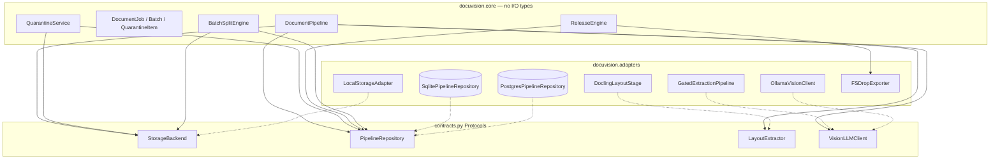

The practical consequence: you can swap SQLite for Postgres (`FOR UPDATE SKIP LOCKED` vs a SQLite compare-and-set claim), or swap the legacy Ollama path for the gated local-transformer path, without rewriting the orchestrator.

Claiming is concurrent-safe on both backends. `claim_next_queued()` prefers documents in **HIGH** priority batches, then oldest `created_at`. Standalone files use medium priority so a scanner burst cannot starve a clerk-priority packet.

---

## Document state machine

Statuses are not stringly-typed. They are loaded from `contracts/pipeline-status.json` into a Python `Enum` **and** imported as a TypeScript const. The worker records every transition through `PipelineRepository.update_status`, which also appends to `pipeline_events`.

Happy path:

```text
QUEUED → SCANNING → LAYOUT → VISION → STAGING → PENDING_VERIFICATION → VERIFIED
```

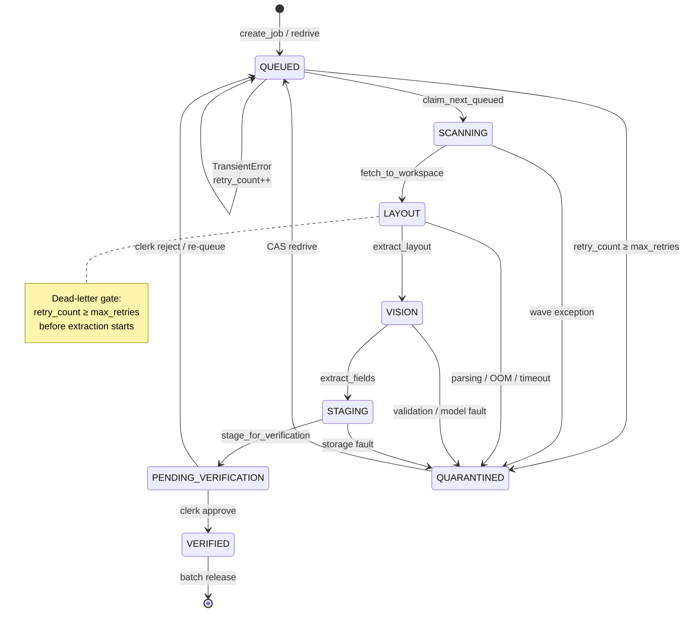

Each wave is wrapped in `execute_with_quarantine_boundary`. `TransientError` is the only exception that is allowed to escape and re-queue. Everything else becomes a `QuarantineBoundaryError` carrying the original traceback, classified into a `QuarantineReason`:

`PARSING_ERROR` · `VRAM_OOM` · `VALIDATION_FAILED` · `NETWORK_TIMEOUT` · `RETRY_EXHAUSTED` · `INFRASTRUCTURE_ERROR` · `PROCESSING_ERROR`

Coarse lifecycle for the control-center UI collapses those stages into five states (`PENDING` / `PROCESSING` / `COMPLETED` / `FAILED` / `QUARANTINED`) via `lifecycle_status()`.

HITL aliases on the API (so clerks see operational language, not worker internals):

| API name | Persisted status |
| --- | --- |
| `VERIFYING` | `PENDING_VERIFICATION` |
| `APPROVED` | `VERIFIED` |

---

## Batch state machine

A **batch** is the unit a clinic or mailroom actually cares about: a folder drop, a stapler of pages, a scanner session. Documents are members with a `sequence_no`. The batch only becomes ready for a human when *every* member has reached `PENDING_VERIFICATION` or `VERIFIED`.

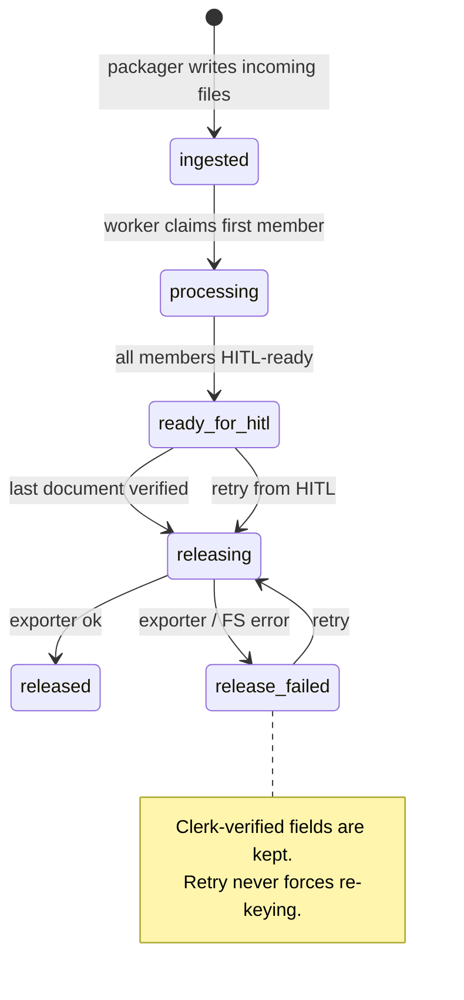

Priorities (`contracts/batch-status.json`): `LOW=1`, `MED=2`, `HIGH=3`. The supervisor queue orders `HIGH` first, then FIFO.

Physical multi-document PDFs can be split *in place* by `BatchSplitEngine`:

- **barcode** — page containing a configured separator value (default `DOC-BREAK`)
- **blank_page** — ink density below a threshold
- **fixed_interval** — every *N* pages

The parent becomes `SPLIT_PARENT`. Children are new `QUEUED` jobs with lineage in `document_split_lineage` (migration 004). The split is idempotent: replaying the same parent returns the existing children.

---

## Two extraction backends

`DOCUVISION_EXTRACTION_BACKEND` selects the vision implementation behind the same `VisionLLMClient` protocol.

### Legacy: classify → schema → Ollama

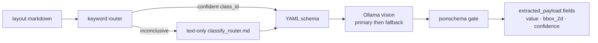

Semantic contracts live in `config/schemas/*.yaml`. They are **field meanings**, not pixel templates. `scripts/generate_field_types.py` emits `src/lib/form-types.gen.ts` so the HITL form cannot drift from the Python registry.

Classification prefers an offline keyword pre-pass. Only an inconclusive match spends a small JSON-mode chat against `config/prompts/classify_router.md`. Vision then uses the heavy VL model, with a lighter fallback on `ModelRecoverableError`.

### Gated: memory-bounded waves

On a Mini PC, loading Docling, GLM-OCR, and Qwen-VL in one process is a VRAM leak waiting to happen. The gated engine treats each stage as a **fresh spawned process** with an RSS ceiling. A worker exit returns native allocator state even when a library cache cannot be cleared.

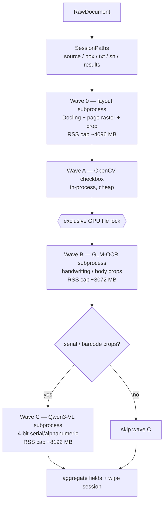

Region routing from Docling labels:

| Crop bucket | Typical labels | Reader |
| --- | --- | --- |
| `box/` | checkbox | pixel + contour density vs threshold |
| `txt/` | paragraph, handwriting, table, form | GLM-OCR |
| `sn/` | barcode, serial, key_value, `[A-Za-z0-9._:/-]` pattern | Qwen3-VL |

`DeferredGatedLayoutStage` is a marker: the pipeline’s LAYOUT step records a deferred token; the gated vision stage owns the sole Docling pass so layout is not run twice.

Timeouts, RSS overruns, and missing worker output all become `GatedExtractionError(stage, …)`, which the orchestrator quarantines rather than taking down `run_worker.py`.

---

## Human-in-the-loop station

The UI is a static export (`next.config.ts` → `output: "export"`). There is no Next.js server. All mutation goes through FastAPI.

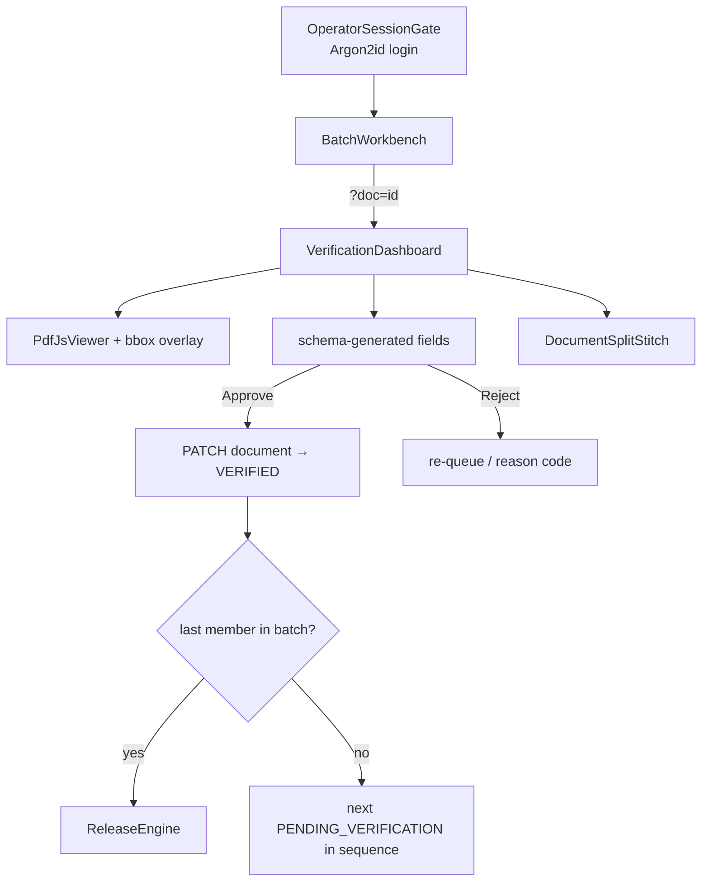

Geometry is stored twice on purpose:

- `bbox_2d` — absolute pixels in the processed image (model-native)
- `normalized_bbox` — `[x1,y1,x2,y2]` on a **0–1000** scale, resolution-independent

The overlay accepts fractional, 0–1000, or absolute boxes so older payloads still highlight. Clerk edits preserve confidence and bbox metadata (`buildVerifiedPayload`).

Tauri adds two native capabilities the browser cannot:

1. Read the per-user `token.lock` handshake written by `run_api.py`
2. TWAIN acquire (`src-tauri/src/scanner/`) into `$APPCACHE/scans`, plus OS keyring storage for the operator session

---

## Fault domain: quarantine and redrive

Quarantine is a durable attempt record, not a folder with a sad PDF in it.

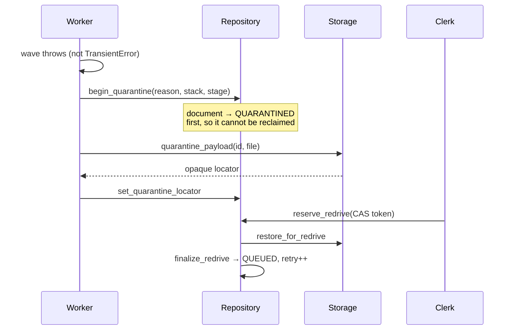

Order matters: **DB transition first**. If the process dies after `begin_quarantine` but before the file move, the worker will not claim the document again. Redrive can recover from incoming / failed / verification roots when no locator was recorded.

`QuarantineService` also surfaces legacy `FAILED` rows so the clerk queue is one list. Concurrent redrives lose on the CAS token rather than double-queueing.

---

## Auth, on a machine that is not on the internet

Two independent gates, because a stolen loopback key and a stolen clerk password are different threats.

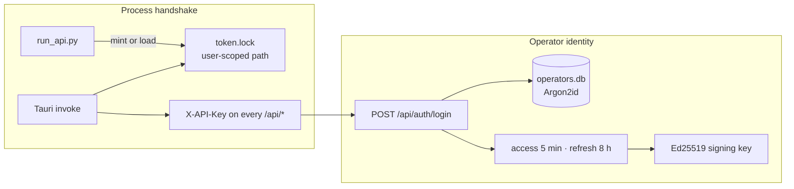

Sensitive routes require both headers. Passwords are never CLI arguments (`manage_operators.py` prompts). Lockout is local: failed-attempt counter + cooldown in settings.

---

## Shared contracts and codegen

Polyglot status drift is a class of bug this repo refuses to have.

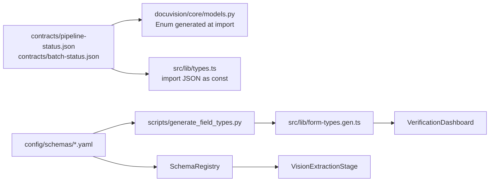

SQL migrations are written in a least-common-denominator dialect (TEXT UUIDs, TEXT ISO-8601 timestamps, TEXT JSON) so the same files apply to SQLite 3.35+ and PostgreSQL 12+. Postgres can later `ALTER … TYPE JSONB / TIMESTAMPTZ` without changing application code.

---

## Persistence sketch

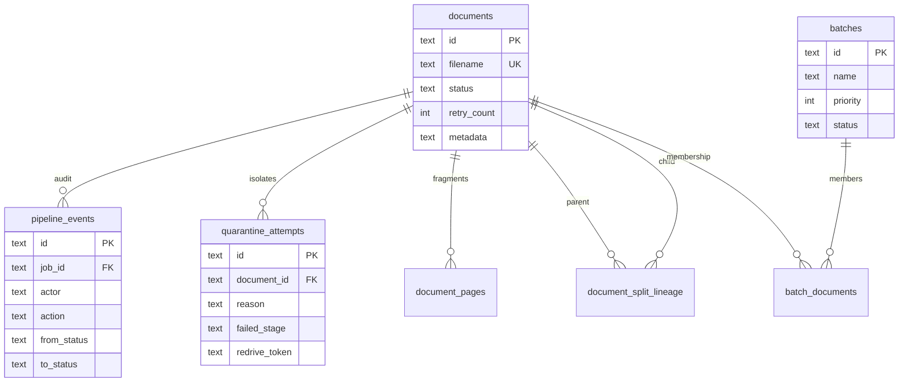

Operational payloads (`local_path`, `extracted_payload`, `verified_payload`) live in `documents.metadata` JSON so the worker can evolve field shape without a migration per model version. HITL read paths keep nested `{ value, bbox_2d, normalized_bbox, confidence }` objects — never double-encoded strings.

---

## Repository map

Read this as a guided tour, not a file dump. Bold paths are the ones a reviewer should open first.

```text
DocuVision/
├── contracts/                      ★ source of truth for status enums
│   ├── pipeline-status.json
│   └── batch-status.json
├── config/
│   ├── schemas/                    semantic field contracts (YAML)
│   ├── prompts/classify_router.md  LLM classification fallback
│   └── ingestion_sources.yaml      scanner / NFS drop registry
├── migrations/                     dual-engine SQL (SQLite + Postgres)
│   ├── 001_documents_pipeline_events.sql
│   ├── 002_batch_domain.sql
│   ├── 003_pipeline_quarantine.sql
│   └── 004_document_split_lineage.sql
│
├── docuvision/                     ★ Python domain
│   ├── core/                       Protocol-only orchestration
│   │   ├── pipeline.py             state machine
│   │   ├── contracts.py            Storage / Repo / Layout / Vision
│   │   ├── models.py               jobs, batches, quarantine
│   │   ├── quarantine.py           list + CAS redrive
│   │   ├── release.py              Pillar 5 export engine
│   │   ├── batch_splitting.py      barcode / blank / interval
│   │   ├── errors.py
│   │   └── observability.py        JSON logs + correlation id
│   ├── stages/
│   │   ├── layout.py               Docling (legacy)
│   │   ├── classification.py       keyword then optional LLM
│   │   ├── vision_extraction.py    schema-driven Ollama
│   │   └── gated_extraction.py     ★ resource-gated waves
│   ├── registry/schema_registry.py YAML → jsonschema + TS codegen
│   ├── adapters/                   I/O implementations
│   │   ├── local_storage.py
│   │   ├── sqlite_repository.py    CAS claim
│   │   ├── postgres_repository.py  SKIP LOCKED claim
│   │   ├── ollama_client.py
│   │   ├── pdf_batch_splitter.py
│   │   ├── local_model_process.py  transformer crop worker
│   │   ├── ingestion/              watcher, packager, heartbeat
│   │   └── release/                FS drop exporter
│   ├── api/                        FastAPI factory + routers
│   └── composition.py              DI root
│
├── run_ingestion.py                Pillar 1 daemon
├── run_worker.py                   pipeline poll loop
├── run_api.py                      sole HTTP entry (HITL overlays)
├── manage_operators.py             offline account provisioning
│
├── src/                            Next.js 16 HITL station
│   ├── app/page.tsx                queue ↔ detail via ?doc=
│   ├── app/ingestion/page.tsx      dropzone + source heartbeat
│   ├── components/                 workbench, viewer, overlay, split
│   ├── hooks/                      scanner, hotkeys, remote status
│   └── lib/
│       ├── types.ts                contract-backed TS types
│       ├── form-types.gen.ts       generated from YAML
│       └── api.ts                  handshake + JWT client
│
├── src-tauri/                      desktop shell
│   └── src/
│       ├── lib.rs                  token.lock + keyring session
│       ├── commands.rs             scan acquire (busy CAS)
│       └── scanner/twain.rs
│
├── scripts/generate_field_types.py YAML → TypeScript
├── compose.yaml                    worker + ingestion + api + web
├── quarantine/                     retired cloud watcher (do not import)
└── test_*.py                       domain tests as executable spec
```

### Where to look, by curiosity

| If you want to understand… | Open |
| --- | --- |
| The entire product in one file | `docuvision/core/pipeline.py` |
| Why core cannot import Docling or SQLite | `docuvision/core/contracts.py` |
| How a Mini PC survives VLM inference | `docuvision/stages/gated_extraction.py` |
| How a clerk sees model geometry | `src/lib/types.ts` + `src/components/PdfJsViewer.tsx` |
| How a folder of scans becomes a batch | `docuvision/adapters/ingestion/watcher.py` |
| How verified data leaves the building | `docuvision/core/release.py` |
| How Python and TS cannot disagree on `"QUEUED"` | `contracts/pipeline-status.json` |
| How the desktop proves it is the local API | `docuvision/api/auth.py` + `src-tauri/src/lib.rs` |

Retired cloud-era modules (Supabase watcher, old Ollama helper) sit in `quarantine/` and are **not** on `PYTHONPATH`. See `quarantine/README.md`.

---

## End-to-end path of one packet

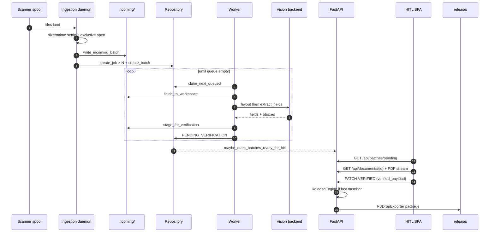

Settle lock: a file is not packaged until size and mtime are unchanged for `settle_seconds` **and** an exclusive read open succeeds (Windows share mode / POSIX). That is what stops the daemon from ingesting a TIFF the scanner is still writing.

---

## Local run

Air-gapped defaults: SQLite under `data/docuvision.db`, API on `127.0.0.1:8000`, Ollama on the LAN Mini PC.

```bash
# Python
python -m venv .venv
# Windows: .venv\Scripts\activate
pip install -r requirements.txt
copy .env.example .env   # then point Ollama at your Mini PC

python manage_operators.py create jsmith --display-name "Jane Smith"
python run_api.py          # terminal 1
python run_worker.py       # terminal 2
python run_ingestion.py    # terminal 3 — optional if you ingest via the UI

# UI
npm install
# set NEXT_PUBLIC_LOCAL_API_KEY to match LOCAL_API_KEY for browser-only dev
npm run dev
# or: npm run tauri:dev
```

Docker (same three processes + static web):

```bash
docker compose up --build
# with bundled Ollama: docker compose --profile ollama up --build
```

Drop files into the path declared in `config/ingestion_sources.yaml` (default `data/drops/scanner_a`), or use the ingestion page. After extraction, open the workbench, verify, and find the package under `data/release/`.

---

## Tests as specification

The `test_*.py` modules are meant to be read as executable design notes:

| File | Claims it protects |
| --- | --- |
| `test_pipeline_faults.py` | transient retry, dead-letter, quarantine boundary |
| `test_quarantine_redrive.py` | CAS reserve, restore, no double-claim |
| `test_gated_extraction.py` | session isolation, wave skip, RSS/timeout errors |
| `test_schema_registry.py` | YAML → jsonschema, bbox normalize, classify |
| `test_batch_domain.py` / `test_batch_splitting.py` | membership, split lineage, idempotent replay |
| `test_release_engine.py` | verified-fields survive `release_failed` |
| `test_ingestion_watcher.py` | settle lock, batch window, poll vs watchdog |
| `test_egress_exporters.py` | FS drop package shape |
| `test_api_auth.py` | handshake key + operator JWT |

```bash
pytest -q
```

---

## Constraint that shapes everything else

This system is designed to run **next to a scanner**, on a clinic or mailroom LAN, with a GPU Mini PC as the only “cloud.” That constraint is why:

- storage is directories, not buckets
- identity is Argon2id in a local SQLite file, not a hosted IdP
- the SPA is a static export inside Tauri, not a Node server
- extraction is a state machine with quarantine, not a single `try/except` around `model.generate`
- schema YAML is checked into git, so a new form type is a contract change, not a prompt buried in a notebook

The code is the argument. Follow a document id from `create_job` through `pipeline_events` and you can reconstruct every decision the system made — including the ones that failed.
